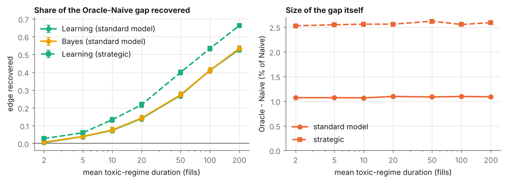

# Market making under hidden toxicity regimes

A simulation study of a market maker whose order flow switches between a calm regime (5% of
fills come from informed traders) and a toxic one (40%), without being told which.

**Question.** How much does the market maker lose by ignoring the switching, how much can it
win back by inferring the regime from the markouts of its own fills, and how close is a simple
"plug in the estimate" rule to the Bayes-optimal strategy?

## The five market makers

All are run on identical simulated paths, so differences between them are measured precisely.

- **Baseline** ignores adverse selection.
- **Naive** knows the average informed share and quotes for it.
- **Oracle** sees the regime.
- **Learning** runs a hidden-Markov filter on its own markouts and quotes as if its current
  estimate were the truth.
- **Bayes** solves the full control problem with the belief as a state variable.

## Result

| | standard flow | strategic informed trader |
|---|---|---|
| Value of knowing the regime (Oracle over Naive) | 1.06% ± 0.02% of the objective | 2.59% ± 0.03% (up to 100%+ when impact is large) |
| Share of that value recovered by Learning, regimes of 20 fills | 14% ± 1% | 23% ± 1% |
| Same, regimes of 200 fills | 53% ± 2% | 66% ± 1% |
| Learning's gain as a share of Bayes's gain | 99% | 100% when toxicity is mild, 62% when severe (exploratory) |

Under standard assumptions, knowing the toxicity regime is worth about 1% of profit, because
profit is flat around the optimal quote; a closed-form approximation, ½(kη)²·Var(π), predicts
the simulated gap across 27 parameter sets. Learning becomes valuable only when informed
traders are less price-sensitive than everyone else, so that the right response to toxicity is
to stop quoting. See [REPORT.md](REPORT.md).




## Repo

| | |
|---|---|
| [REPORT.md](REPORT.md) | model, verification, results, limitations |
| [THEORY_NOTES.md](THEORY_NOTES.md) | derivations: HJB, adverse selection, the filter |
| `experiments/` | one script per experiment (E0–E8, X1), plus figures |
| `tests/` | unit tests and the verification gate |
| `results/`, `figures/` | outputs of the full run |

The model lives in `toxicmm/`:

```
toxicmm/params.py                 parameters (baseline from Guéant-Lehalle-Fernandez-Tapia 2013)
toxicmm/hjb.py                    optimal quotes when the regime is known
toxicmm/likelihood.py             distribution of a fill's markout
toxicmm/belief_hjb.py             Bayes-optimal quotes when the regime is hidden
toxicmm/belief_hjb_strategic.py   same, strategic informed trader (exploratory extension)
toxicmm/simulate.py               Monte Carlo simulator and the online filter (Numba)
toxicmm/market_makers.py          Baseline, Naive, Oracle, Learning, Bayes
```

## Run it

Tested with Python 3.13.

```
pip install -r requirements.txt
python -m pytest -q                       # about 2 minutes, includes the verification gate
PATH_SCALE=0.05 sh run_all.sh             # quick pass, roughly 45 minutes on 2 cores
sh run_all.sh                             # full run, roughly 2-3 hours on 2 cores
```

A single experiment: `python -m experiments.e1_main`. Results go to `results/*.json`, figures
to `figures/`.

## Main references

Avellaneda & Stoikov (2008); Guéant, Lehalle & Fernandez-Tapia (2013); Cartea, Jaimungal &
Penalva (2015); Glosten & Milgrom (1985). Full list in THEORY_NOTES.md.
