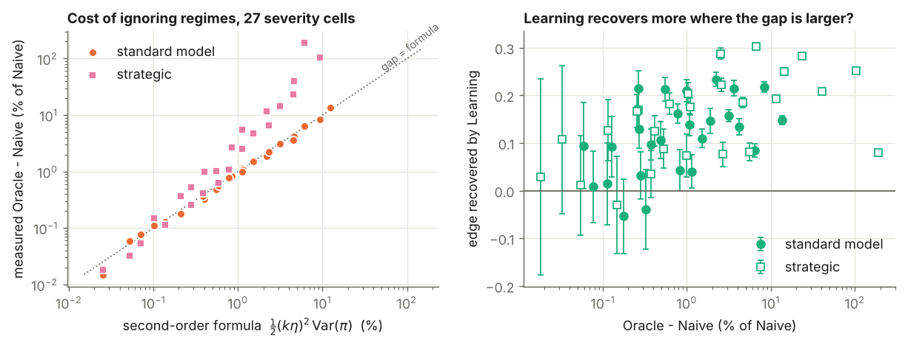
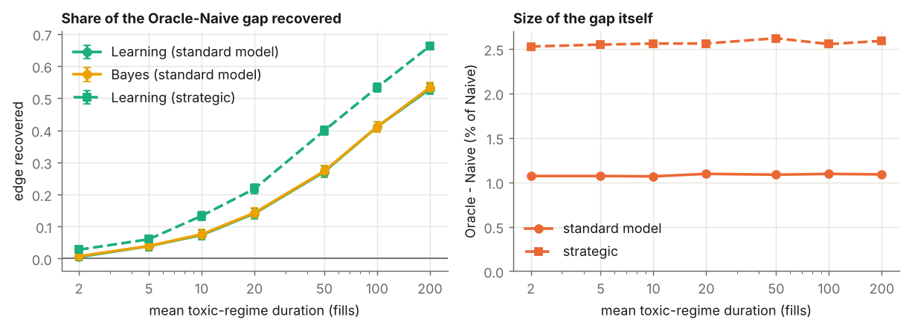
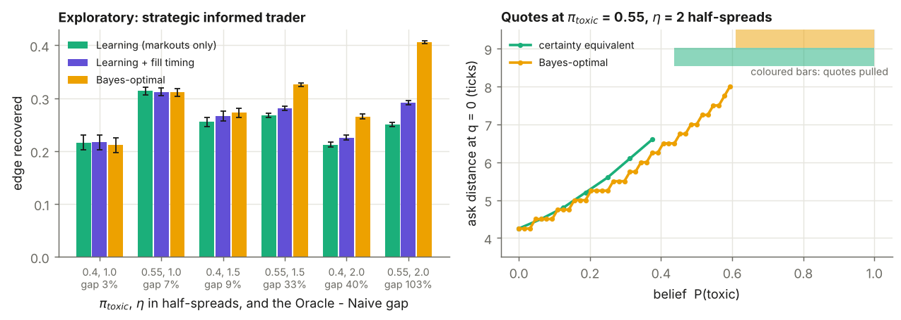
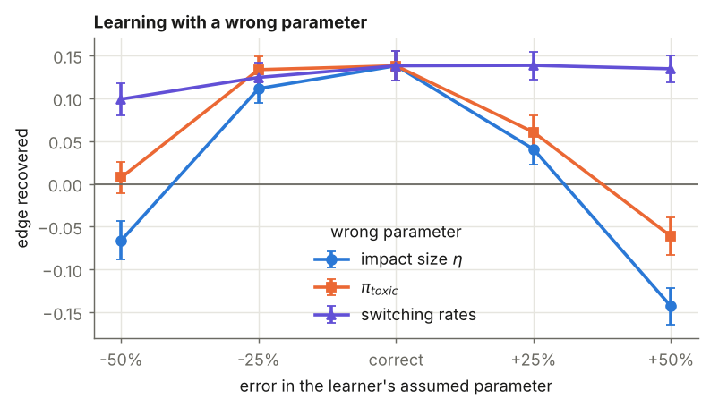

# Market making under hidden toxicity regimes

## Question

The informed share of a market maker's order flow switches between a calm regime (5%) and a
toxic one (40%), and the market maker cannot see which. How much does ignoring this cost, how
much can be recovered by inferring the regime from the markouts of its own fills, and how
close does a simple plug-in rule get to the Bayes-optimal one?

## Model

- Fills arrive with intensity A·e^{−kδ} per side at quote distance δ. A = 0.9/s, k = 0.3/tick,
  σ = 0.3, T = 600 s, from Guéant, Lehalle & Fernandez-Tapia (2013).
- A hidden two-state Markov chain sets the informed share π ∈ {0.05, 0.40}. The toxic regime
  holds 25% of the time and lasts 20 fills on average.
- An informed order is followed about 0.25 s later by a price jump in its direction, of mean
  η = 1/k (one half-spread). This happens whether or not the market maker fills it. Other jumps
  keep total jump activity equal in both regimes, so the public price does not reveal the
  regime.
- The market maker observes the markout of each fill, i.e. the mid move over the next 0.5 s.
- Objective: P&L − 0.5·q_T² − 0.1·∫q² dt.

| market maker | knows | quotes |
|---|---|---|
| Baseline | nothing about informed flow | HJB with π = 0 |
| Naive | average π (13.75%) | HJB with constant π̄ |
| Oracle | current regime | regime-switching HJB |
| Learning | filtered P(toxic) | constant-π HJB at the estimate (certainty equivalence) |
| Bayes | filtered P(toxic) | HJB with the belief as a state variable |

All five run on the same simulated paths. Two informed-trader models are compared:
- **Standard.** Informed orders respond to the quote like uninformed ones.
- **Strategic.** The informed trader trades only if the jump exceeds the quote.

Derivations are in [THEORY_NOTES.md](THEORY_NOTES.md).

## Verification

- **HJB vs Monte Carlo.** The simulated objective equals the HJB value within the 95% CI. This
  was checked for Naive, Oracle and Bayes at three parameter sets, plus the strategic model,
  with 200k–400k paths each (`experiments/e0_verification.py`). The test uses a setting where
  the HJB is exact: the jump is immediate and the signal is observed at the fill.
- **Filter.** The filter matches an independent reference implementation
  (`tests/test_likelihood_and_filter.py`).
- **No look-ahead.** Re-drawing all randomness after t = 300 s leaves every belief and fill
  before 300 s bit-identical.

## Results

### 1. Knowing the regime is worth about 1%

Central setting, 400,000 paths (ticks; ± is the 95% CI):

| | objective | P&L / s | fills | adverse selection / fill |
|---|---|---|---|---|
| Baseline | 968.3 ± 0.5 | 1.773 | 367 | 0.46 |
| Naive | 978.3 ± 0.5 | 1.778 | 318 | 0.46 |
| Learning | 979.8 ± 0.5 | 1.781 | 319 | 0.45 |
| Bayes | 979.8 ± 0.5 | 1.781 | 319 | 0.45 |
| Oracle | 988.7 ± 0.5 | 1.796 | 322 | 0.39 |

Oracle beats Naive by 1.06% ± 0.02%.
- **Why so little.** Profit is flat near the optimal quote, so the loss from a slightly wrong
  quote is second order. The approximation ½(kη)²·Var(π) gives 1.15% here.
- **Across settings.** Across 27 combinations of π_toxic, η and time share, the gap ranges
  from 0.01% to 13.7%. The formula's ratio to the measured gap has median 0.95 (range
  0.58–1.12).
- **Naive never loses money.** It stays profitable in every cell, even inside toxic regimes.

### 2. Learning recovers a fraction, depending on regime length

Edge recovered is (Learning − Naive) / (Oracle − Naive):

| toxic regime length (fills) | 2 | 5 | 10 | 20 | 50 | 100 | 200 |
|---|---|---|---|---|---|---|---|
| standard | 0.01 | 0.04 | 0.07 | 0.14 | 0.27 | 0.41 | 0.53 |
| strategic | 0.03 | 0.06 | 0.13 | 0.22 | 0.40 | 0.53 | 0.66 |

A single markout is weak evidence: the best single-fill classifier is 77% accurate at even
odds. With 20-fill regimes the filter crosses P(toxic) > ½ in only half of toxic episodes,
after a median of 7 fills.

### 3. Certainty equivalence is as good as Bayes-optimal in the standard model

Learning gains 1.50 ± 0.14 over Naive and Bayes gains 1.51 ± 0.14. The two are statistically
indistinguishable at every regime length, risk aversion and misspecification tested. Their
quotes differ by at most 0.014 ticks at zero inventory.

### 4. Strategic informed traders change the picture

- **Central setting.** The Oracle–Naive gap rises to 2.59%. Learning recovers 23% of it.
- **Severe settings** (η = 2/k, π_toxic ≥ 0.4). The gap is 12% to over 100% of Naive's
  objective, and Naive loses money inside toxic regimes. At π_toxic = 0.55 it loses −1.99/s,
  against −0.74/s for Learning and −0.10/s for Oracle. Here the right response to toxicity is
  to pull quotes, not to widen slightly, so the second-order argument no longer holds.
- **Belief-state HJB for this model** (exploratory, not in the original plan). At the most
  severe setting certainty equivalence captures only 62% of the Bayes-optimal gain. When
  toxic half the time, Naive and Learning stop quoting entirely and earn 0. Bayes keeps
  quoting at a small expected loss to learn the regime, and earns 0.27/s against the Oracle's
  0.76/s.

### 5. Robustness

The learner's assumed parameters were set wrong on purpose:
- **Switching rates off by ±50%:** little effect.
- **Impact η or π_toxic off by ±25%:** Learning still beats Naive.
- **η off by ±50%:** Learning loses to Naive (−0.70 and −1.52 vs +1.47 correctly specified).
  A wrong average spread is a first-order error and outweighs the second-order gain from
  tracking the regime.
- **Different true market** (continuous toxicity, three regimes, constant or lognormal
  jumps): Learning beats Naive in all four cases.

## Limitations

- **Assumed parameters.** Nothing is calibrated to market data. In particular, a quoted
  spread of about 8 ticks is far wider than in a liquid stock, so absolute P&L is not
  meaningful. Only the comparisons between market makers are.
- **Uninformative public price.** By construction the price says nothing about the regime. In
  practice volatility, volume and order-book imbalance carry regime information, and a market
  maker using them would learn faster.
- **Simplified market.** There is a single market maker with no competition, and tick size,
  queue position, latency and fees are ignored.
- **Approximate benchmarks.** With delayed impact and overlapping markout windows, Oracle and
  Bayes are close to optimal but not exactly optimal.
